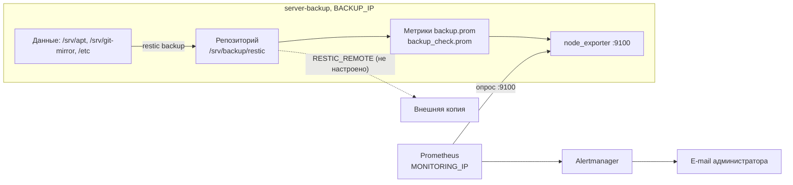

# Резервное копирование на restic
 
## Содержание
 
- [Краткое описание](#краткое-описание)
- [Состав серверов](#состав-серверов)
- [Схема взаимодействия](#схема-взаимодействия)
- [Требования к инфраструктуре](#требования-к-инфраструктуре)
- [Что установить заранее](#что-установить-заранее)
- [Описание файлов](#описание-файлов)
- [Развёртывание](#развёртывание)
- [Использование и проверка](#использование-и-проверка)
- [Алерты](#алерты)
- [Дополнительные комментарии](#дополнительные-комментарии)
## Краткое описание
 
Ветка содержит два deb-пакета и их исходники для резервного копирования сервера `server-backup` и контроля его работы из Prometheus. Ежедневно в 02:00 создаётся снапшот restic, по воскресеньям в 04:00 проверяется репозиторий и тестово восстанавливается файл. Результаты уходят в метрики, при сбоях срабатывают алерты.
 
## Состав серверов
 
Вместо `BACKUP_IP` и `MONITORING_IP` подставьте адреса своих серверов.
 
| Сервер | Адрес | Что ставится |
|---|---|---|
| `server-backup` | `BACKUP_IP` | Пакет `backup-storage` 1.3, restic, node_exporter |
| `server-monitoring` | `MONITORING_IP` | Пакет `prometheus-config` 1.3 (правила алертов) |
 
## Схема взаимодействия
 

 
## Требования к инфраструктуре
 
- ВМ `server-backup` с Ubuntu 24.04, 2 vCPU, 2 ГБ RAM, диск с запасом по объёму данных (в проекте 40 ГБ).
- Уже работающий сервер мониторинга (ветка `monitoring`).
- Порт 22/tcp только с адресов администраторов, порт 9100/tcp на `server-backup` только с `MONITORING_IP`.
- Менеджер паролей для пароля репозитория restic и офлайн-копия этого пароля.
## Что установить заранее
 
- На `server-backup`: `restic` и `prometheus-node-exporter` (пакет `backup-storage` проверяет их наличие). Фаервол: `ufw`.
- На `server-monitoring`: `jq`, уже установленные Prometheus и `promtool`.
## Описание файлов
 
| Путь | Ставится на | Назначение |
|---|---|---|
| `backup-storage_1.3_all.deb` | `server-backup` | Ежедневный бэкап, еженедельная проверка, `backup-storage-selfcheck`, systemd-таймеры |
| `prometheus-config_1.3_all.deb` | `server-monitoring` | Правила алертов (`backup.yml`, `backup-apt.yml`), `prometheus-config-check` |
| `backup-storage-1.3/` | — | Исходники первого пакета: `usr/sbin/`, `etc/backup-storage/backup.conf`, `lib/systemd/system/`, `debian/` |
| `prometheus-config-1.3/` | — | Исходники второго пакета: `etc/prometheus/rules/`, `usr/sbin/prometheus-config-check`, `tests/backup_test.yml`, `debian/` |
 
Компоненты пакета `backup-storage`:
 
| Файл | Назначение |
|---|---|
| `backup-storage-run` | Создаёт снапшот, чистит старые копии, пишет метрики |
| `backup-storage-check` | Еженедельная проверка репозитория и тестовое восстановление |
| `backup-storage-selfcheck` | Диагностика: конфиг, пароль, репозиторий, таймеры, метрики |
| `backup-storage.timer` | Ежедневный запуск (02:00) |
| `backup-storage-check.timer` | Еженедельная проверка (воскресенье, 04:00) |
 
Параметры `/etc/backup-storage/backup.conf`:
 
| Параметр | По умолчанию | Смысл |
|---|---|---|
| `RESTIC_LOCAL` | `/srv/backup/restic` | Локальный репозиторий |
| `RESTIC_REMOTE` | пусто | Внешняя копия (SFTP или S3), пусто означает «не копировать» |
| `RESTIC_PASSWORD_FILE` | `/etc/restic/password` | Файл с паролем репозитория |
| `BACKUP_PATHS` | `/srv/apt /srv/git-mirror /etc` | Что копировать |
| `PG_DB` | пусто | База PostgreSQL для дампа |
| `KEEP_DAILY`, `KEEP_WEEKLY`, `KEEP_MONTHLY` | 7, 4, 6 | Политика хранения |
| `METRIC_DIR` | `/var/lib/node_exporter/textfile` | Каталог метрик для node_exporter |
 
## Развёртывание
 
**1. Сервер бэкапов (`server-backup`)**
 
```bash
sudo apt install /tmp/backup-storage_1.3_all.deb      # на вопрос про backup.conf: N
sudo sh -c 'mkdir -p /etc/restic && openssl rand -base64 32 > /etc/restic/password && chmod 600 /etc/restic/password'
sudo cat /etc/restic/password                          # сохранить в менеджер паролей и офлайн-копию
export RESTIC_PASSWORD_FILE=/etc/restic/password
sudo -E restic -r /srv/backup/restic init
sudo nano /etc/backup-storage/backup.conf              # BACKUP_PATHS, METRIC_DIR, при необходимости PG_DB / RESTIC_REMOTE
sudo systemctl start backup-storage.service
sudo systemctl start backup-storage-check.service
sudo systemctl enable --now backup-storage.timer backup-storage-check.timer
sudo backup-storage-selfcheck
```
 
`METRIC_DIR` должен совпадать с textfile-каталогом node_exporter. В Ubuntu пакет `prometheus-node-exporter` читает `/var/lib/prometheus/node-exporter`, а в `backup.conf` по умолчанию другой путь (`/var/lib/node_exporter/textfile`). Проверьте и при необходимости исправьте, иначе Prometheus не увидит метрик бэкапа.
 
**2. Сервер мониторинга (`server-monitoring`)**
 
```bash
sudo apt install jq /tmp/prometheus-config_1.3_all.deb
```
 
В `/etc/prometheus/prometheus.yml` один раз добавьте `rule_files: ['/etc/prometheus/rules/*.yml']` и job `backup-host` с адресом `BACKUP_IP:9100` (отступы одинаковые, только пробелы). Затем:
 
```bash
sudo promtool check config /etc/prometheus/prometheus.yml
sudo systemctl reload prometheus
sudo prometheus-config-check
```
 
## Использование и проверка
 
Восстановление из бэкапа:
 
```bash
export RESTIC_PASSWORD_FILE=/etc/restic/password
REPO=/srv/backup/restic
restic -r $REPO snapshots                              # список снапшотов
restic -r $REPO restore latest --target /tmp/restore   # восстановление во временный каталог
```
 
Проверка работоспособности: `sudo backup-storage-selfcheck`, `systemctl list-timers 'backup-storage*'`, `curl -s localhost:9100/metrics | grep ^backup_`.
 
Проверка алерта на тестовых данных:
 
```bash
echo "backup_last_success_timestamp_seconds $(( $(date +%s) - 108000 ))" | sudo tee /var/lib/prometheus/node-exporter/backup.prom
# через 10 минут BackupTooOld должен перейти в firing: http://localhost:9090/alerts (через SSH-туннель)
sudo systemctl start backup-storage.service            # вернуть метрику в норму
```
 
Тесты правил: `prometheus-config-1.3/tests/backup_test.yml` (запуск `promtool test rules`).
 
## Алерты
 
| Алерт | Условие |
|---|---|
| `BackupTooOld` (critical) | Бэкапа не было более 26 часов |
| `BackupCheckTooOld` (warning) | Проверка не выполнялась более 8 суток |
| `BackupHostDown` (critical) | `server-backup` недоступен 5 минут |
| `BackupDiskAlmostFull` (warning) | Меньше 15% свободного места на `/` или `/srv` |
| `BackupDiskWillFillIn24h` (warning) | Диск заполнится за 24 часа |
| `AptRepoUnavailable` | Проба `blackbox-apt` не отвечает. Нужен job `blackbox-apt`, без собственного apt-репозитория правило не нужно |
 
## Дополнительные комментарии
 
**Сборка пакетов.**
 
```bash
cd backup-storage-1.3 && dpkg-buildpackage -us -uc -b
cd ../prometheus-config-1.3 && dpkg-buildpackage -us -uc -b
```
 
Текущие `.deb` собраны через `dpkg-deb` без debhelper. Перед публикацией в apt-репозиторий пересоберите и запустите `lintian`.
 
**Известные ограничения.**
 
- Копируются только каталоги самого `server-backup`. Данные CA, VPN-сервера и мониторинга в бэкап не попадают, ключ CA нигде не сохранён.
- Внешней копии нет (`RESTIC_REMOTE` пуст): при потере диска `server-backup` данные потеряны.
- Во всех пакетах стоит заглушка `Ваше Имя <you@example.com>`.
- Таймеры при установке не включаются: сначала нужны репозиторий restic и конфиг.
 
