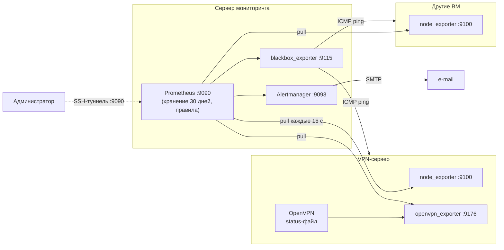

# Мониторинг инфраструктуры: Prometheus + Alertmanager + OpenVPN

Готовое к развёртыванию решение для мониторинга виртуальных машин и OpenVPN-сервера:
сбор метрик, 33 алерта, отправка уведомлений на e-mail, deb-пакеты и скрипты автоматизации,
защита серверов через `iptables`.

  

## Содержание

1. [Описание проекта](#описание-проекта)
2. [Состав серверов](#состав-серверов)
3. [Схема взаимодействия](#схема-взаимодействия)
4. [Требования](#требования)
5. [Быстрый старт](#быстрый-старт)
6. [Подробное развёртывание](#подробное-развёртывание)
7. [Что мониторится и какие алерты](#что-мониторится-и-какие-алерты)
8. [Безопасность](#безопасность)
9. [Проверка работоспособности](#проверка-работоспособности)
10. [Структура репозитория и описание файлов](#структура-репозитория-и-описание-файлов)
11. [Сборка пакетов из исходников](#сборка-пакетов-из-исходников)
12. [Типичные проблемы](#типичные-проблемы)
13. [Дополнительные комментарии](#дополнительные-комментарии)

## Описание проекта

Проект решает три задачи:

- **Метрики ВМ.** Единый набор инфраструктурных метрик (CPU, память, диск, сеть, systemd, время и др.) на всех машинах через `node_exporter`.
- **Мониторинг OpenVPN.** Состояние сервиса, интерфейс `tun0`, число клиентов, трафик, слушается ли порт, срок действия сертификатов.
- **Оповещения.** Prometheus вычисляет правила (PromQL), Alertmanager группирует алерты и отправляет их на e-mail, в том числе о восстановлении.

Всё разворачивается двумя deb-пакетами (или скриптами): `monitoring-server` и `monitoring-agent`.

## Состав серверов

| Роль | Что установлено | Порты |
|---|---|---|
| **Сервер мониторинга** (`MON`) | Prometheus, Alertmanager, blackbox_exporter, node_exporter | 9090, 9093, 9115 — только `127.0.0.1` |
| **VPN-сервер** (`VPN`) | OpenVPN, node_exporter, openvpn_exporter, `monitoring-agent` | 9100, 9176 — только для IP `MON` |
| **Другие ВМ** (`VM`) | node_exporter, `monitoring-agent` | 9100 — только для IP `MON` |

Рекомендуется держать Prometheus на **отдельной** машине: если он стоит на наблюдаемом сервере, при падении этого сервера алерт не будет отправлен.

## Схема взаимодействия



Принцип работы: Prometheus сам опрашивает экспортёры (**pull**). Экспортёры отдают метрики по `GET /metrics`.
Prometheus каждые 15 секунд проверяет правила; сработавшие алерты передаются в Alertmanager, который
группирует их, подавляет лишние (если машина недоступна, остальные её алерты не шлются) и отправляет письмо.

## Требования

**Инфраструктура**

- 3 ВМ (минимум): сервер мониторинга, VPN-сервер, ещё одна ВМ.
- ОС: Debian 12+ или Ubuntu 22.04/24.04, доступ `root`/`sudo`.
- Сетевая связность: с `MON` до `VM`/`VPN` по TCP 9100 и 9176, ICMP. С `MON` до SMTP-сервера (порт 587 или 465).
- Для сервера мониторинга: 1–2 vCPU, 2 ГБ RAM, 10+ ГБ диска (30 дней хранения для нескольких ВМ).
- Исходящий SMTP не должен блокироваться провайдером (у некоторых облаков закрыт порт 25).

**Что нужно установить заранее**

| Где | Пакеты | Зачем |
|---|---|---|
| все машины | `curl`, `iptables`, `openssl`, `cron` | проверки, фаервол, срок сертификатов |
| `MON` | `prometheus`, `prometheus-alertmanager`, `prometheus-blackbox-exporter`, `libcap2-bin` | ставятся автоматически как зависимости пакета |
| все ВМ | `prometheus-node-exporter` | ставится автоматически |
| `VPN` | `golang-go`, `git` (для сборки `openvpn_exporter`) | либо готовый бинарник в `/usr/local/bin/openvpn_exporter` |
| `MON` (харденинг) | `iptables-persistent`, `fail2ban`, `unattended-upgrades` | ставятся скриптом `harden-server.sh` |

**Почтовый ящик.** Нужны SMTP-сервер, логин и пароль. Для Gmail и Яндекса — **пароль приложения**, а не основной.

**OpenVPN.** В `/etc/openvpn/server/server.conf` должны быть строки:

```
status /var/log/openvpn/openvpn-status.log 10
status-version 2
```

## Быстрый старт

Подставляйте значения **без угловых скобок**. `MON_IP` — адрес сервера мониторинга.

```bash
# 1. Сервер мониторинга
sudo apt install /tmp/monitoring-server_1.2_all.deb
sudo nano /etc/prometheus/targets/node.yml           # адреса ВМ:9100
sudo nano /etc/prometheus/targets/openvpn.yml        # VPN-сервер:9176
sudo nano /etc/prometheus/targets/icmp.yml           # адреса ВМ (ping)
sudo nano /etc/prometheus/alertmanager.yml           # SMTP и получатель
echo 'ПАРОЛЬ_ПОЧТЫ' | sudo tee /etc/monitoring/smtp_password >/dev/null
sudo systemctl restart prometheus-alertmanager

# 2. На каждой ВМ
sudo PROMETHEUS_IP=MON_IP apt install /tmp/monitoring-agent_1.2_all.deb

# 3. На VPN-сервере дополнительно
sudo ./scripts/install-openvpn-exporter.sh

# 4. Проверка
sudo monitoring-check-agent openvpn                  # на VPN-сервере (на других ВМ — без аргумента)
sudo monitoring-check-server --send-test             # на сервере мониторинга

# 5. Харденинг сервера мониторинга (последним шагом)
sudo ADMIN_IP=ВАШ_IP ./scripts/harden-server.sh
```

Кладите `.deb` в `/tmp`, а не в домашнюю папку: иначе `apt` покажет предупреждение про пользователя `_apt`.

## Подробное развёртывание

### Вариант A: deb-пакеты

| Пакет | Что делает при установке |
|---|---|
| `monitoring-server` | Копирует конфиги и правила в `/etc/prometheus`, задаёт прослушивание `127.0.0.1`, хранение 30 дней, включает сервисы. Имеющиеся `targets` и `alertmanager.yml` при обновлении **не перезаписываются** |
| `monitoring-agent` | Настраивает `node_exporter` (systemd- и textfile-коллекторы), ставит фаервол-юнит, cron-скрипты и команду `monitoring-check-agent` |

Установка пакета через `dpkg -i` не подтягивает зависимости. Используйте `apt install ./файл.deb` или после `dpkg -i` выполните `sudo apt --fix-broken install`.

### Вариант B: скрипты (без пакетов)

```bash
sudo scripts/install-server.sh                       # на сервере мониторинга
sudo PROMETHEUS_IP=MON_IP scripts/install-agent.sh   # на ВМ
sudo PROMETHEUS_IP=MON_IP scripts/install-agent.sh openvpn   # на VPN-сервере (+ openvpn_exporter)
```

### Добавление новой ВМ

1. Поставить на ней `monitoring-agent` с `PROMETHEUS_IP=MON_IP`.
2. Дописать адрес в `/etc/prometheus/targets/node.yml` и `icmp.yml` на сервере мониторинга.

Перезапуск Prometheus не нужен: цели подхватываются автоматически (`file_sd`).

### Доступ к веб-интерфейсу

Prometheus слушает только `127.0.0.1`, поэтому на своём компьютере откройте SSH-туннель:

```bash
ssh -L 9090:127.0.0.1:9090 user@MON_IP
```

Затем в браузере: `http://localhost:9090/targets`, `/alerts`, `/graph`.

## Что мониторится и какие алерты

### Метрики (одинаковый набор на всех ВМ)

CPU (включая `iowait`, `steal`), load average, память и swap, OOM-killer, место и inode на дисках, режим read-only ФС, нагрузка диска, ошибки и потери на сетевых интерфейсах, `conntrack`, файловые дескрипторы, синхронизация времени, перезагрузки, состояние systemd-юнитов, признак `reboot-required`.

### Алерты по ВМ (`rules/infra.yml`, 22 правила)

| Алерт | Условие | Важность |
|---|---|---|
| `InstanceDown` | экспортёр не отвечает 2 мин | critical |
| `HostUnreachablePing` | нет ответа на ping 2 мин | critical |
| `HighCpuUsage` | CPU > 85% 10 мин | warning |
| `HighLoad` | load5 на ядро > 2 | warning |
| `HighIowait`, `CpuSteal` | iowait > 30%, steal > 10% | warning |
| `LowMemory` | доступно < 10% памяти | warning |
| `SwapUsedHigh` | swap занят > 50% | warning |
| `OomKillDetected` | сработал OOM-killer | warning |
| `DiskSpaceLow` / `DiskSpaceCritical` | свободно < 15% / < 5% | warning / critical |
| `DiskWillFillIn24h` | диск заполнится за 24 ч (линейный прогноз) | warning |
| `InodesLow` | свободных inode < 10% | warning |
| `FilesystemReadOnly` | ФС перешла в read-only | critical |
| `DiskIoSaturated` | диск загружен > 90% | warning |
| `NetworkErrors` | ошибки/потери пакетов | warning |
| `ConntrackNearLimit` | conntrack > 80% | warning |
| `FileDescriptorsHigh` | дескрипторов > 80% | warning |
| `ClockSkew` | сдвиг времени > 50 мс | warning |
| `UnexpectedReboot` | машина перезагружалась | info |
| `RebootRequired` | нужна перезагрузка > 7 дней | info |
| `SystemdUnitFailed` | юнит в состоянии failed | warning |

### Алерты по OpenVPN (`rules/openvpn.yml`, `rules/openvpn-udp.yml`, 11 правил)

| Алерт | Условие | Важность |
|---|---|---|
| `OpenVPNServiceDown` | юнит `openvpn*` не активен | critical |
| `OpenVPNExporterDown` | `openvpn_up == 0` | critical |
| `OpenVPNPortUnreachable` | TCP-порт недоступен (только для OpenVPN по TCP) | critical |
| `OpenVPNNotListening` | OpenVPN не слушает свой порт | critical |
| `OpenVPNTunDown` | интерфейс `tun0` не поднят | critical |
| `OpenVPNNoClients` | нет клиентов 30 мин | warning |
| `OpenVPNClientsDrop` | число клиентов упало > 50% за 10 мин | warning |
| `OpenVPNTooManyClients` | клиентов больше 100 | warning |
| `OpenVPNTrafficAnomaly` | трафик на `tun0` > 100 Мбит/с | warning |
| `OpenVPNCertExpiringSoon` | сертификат истекает < 30 дней | warning |
| `OpenVPNCertExpiringCritical` | сертификат истекает < 7 дней | critical |

### Как оповещаются

| Важность | Повтор письма |
|---|---|
| critical | каждый час |
| warning | каждые 4 часа |
| info | раз в сутки |

Письмо о восстановлении отправляется всегда. Если машина целиком недоступна (`InstanceDown`), остальные её алерты (warning/info) подавляются.

## Безопасность

| Мера | Реализация |
|---|---|
| Веб-интерфейсы недоступны снаружи | Prometheus, Alertmanager, blackbox слушают только `127.0.0.1`; доступ через SSH-туннель |
| Порты экспортёров закрыты | на каждой ВМ цепочка `iptables` `MONITORING`: порты 9100 и 9176 доступны только с IP Prometheus (и с loopback для локальных проверок) |
| Сервер мониторинга закрыт | `INPUT` по умолчанию `DROP`, SSH только с `ADMIN_IP`, правила сохранены (`iptables-persistent`) |
| SSH | только по ключам, без входа root, 3 попытки (настройки в `sshd_config.d/00-hardening.conf`) |
| Защита от перебора | `fail2ban` для SSH |
| Обновления | `unattended-upgrades` |
| Ядро | `sysctl`: `rp_filter`, запрет redirect/source-route, `syncookies` и др. |
| Секреты | пароль SMTP в `/etc/monitoring/smtp_password` (права 640), не в конфиге |
| Статус-файл OpenVPN | читается экспортёром через группу `nogroup` (права 640), не открыт всем |

> **Осторожно.** `harden-server.sh` оставляет SSH доступным только с `ADMIN_IP`. Перед запуском держите вторую SSH-сессию.
> Если IP динамический, укажите подсеть провайдера (например, `203.0.113.0/24`).
> Если доступ потерян: из открытой сессии выполните `sudo iptables -P INPUT ACCEPT`.

## Проверка работоспособности

Скрипты проверки готовности **ничего не меняют** и возвращают код `0` («ГОТОВО») или `1` («НЕ ГОТОВО»).

```bash
sudo monitoring-check-server [--send-test]   # сервер: сервисы, конфиги, цели UP, правила, почта, безопасность
sudo monitoring-check-agent [openvpn]        # ВМ: node_exporter, метрики, фаервол; с openvpn — tun0, status-файл, экспортёр
```

Ручные проверки на сервере мониторинга:

```bash
# цели
curl -s 127.0.0.1:9090/api/v1/targets | python3 -c 'import sys,json
for t in json.load(sys.stdin)["data"]["activeTargets"]: print(t["health"], t["labels"]["job"], t["scrapeUrl"])'

# активные алерты
curl -s 127.0.0.1:9093/api/v2/alerts | python3 -m json.tool | grep alertname
```

Тест срабатывания алерта: на второй ВМ `sudo systemctl stop prometheus-node-exporter`. Через 2–3 минуты придёт письмо `InstanceDown`,
после `sudo systemctl start prometheus-node-exporter` — письмо о восстановлении.

Порты для посторонних должны быть закрыты: `nc -zv -w 3 VM_IP 9100` с любой машины, кроме Prometheus, даёт таймаут.

## Структура репозитория и описание файлов

```
.
├── README.md
├── server/                          # конфигурация сервера мониторинга
│   ├── prometheus.yml
│   ├── alertmanager.yml
│   ├── blackbox.yml
│   ├── rules/
│   │   ├── infra.yml
│   │   ├── openvpn.yml
│   │   └── openvpn-udp.yml
│   └── targets/
│       ├── node.yml
│       ├── openvpn.yml
│       ├── icmp.yml
│       └── openvpn-port.yml
├── agent/                           # файлы для каждой ВМ
│   ├── monitoring-firewall.sh
│   ├── monitoring-firewall.service
│   ├── monitoring-textfile.cron
│   ├── openvpn-cert-expiry.sh
│   ├── openvpn-listen.sh
│   ├── reboot-required.sh
│   ├── openvpn-exporter.service
│   └── openvpn-status-perms.conf
├── scripts/                         # установка, харденинг, проверки, сборка
│   ├── install-server.sh
│   ├── install-agent.sh
│   ├── install-openvpn-exporter.sh
│   ├── harden-server.sh
│   ├── check-server.sh
│   ├── check-agent.sh
│   ├── lib-check.sh
│   └── build-debs.sh
├── dist/                            # готовые deb-пакеты
│   ├── monitoring-server_1.2_all.deb
│   └── monitoring-agent_1.2_all.deb
└── docs/
    └── screenshots/                 # скриншоты артефактов (см. docs/screenshots/README.md)
```

| Файл | Назначение |
|---|---|
| `server/prometheus.yml` | Главный конфиг Prometheus: интервал 15 с, подключение правил и Alertmanager, 5 заданий опроса |
| `server/alertmanager.yml` | Маршрутизация, группировка, повторы, подавление, e-mail получатель и SMTP |
| `server/blackbox.yml` | Модули проверки: `icmp` (ping) и `tcp_connect` |
| `server/rules/infra.yml` | 22 алерта по ВМ |
| `server/rules/openvpn.yml` | 10 алертов по OpenVPN |
| `server/rules/openvpn-udp.yml` | Алерт: OpenVPN не слушает свой порт (для UDP) |
| `server/targets/*.yml` | Списки машин для опроса (`file_sd`): `node` — :9100, `openvpn` — :9176, `icmp` — ping, `openvpn-port` — TCP-проба (по умолчанию пустая) |
| `agent/monitoring-firewall.sh`, `.service` | Правила `iptables`: порты экспортёров доступны только с IP Prometheus; запускается при загрузке |
| `agent/monitoring-textfile.cron` | Запуск скриптов, которые пишут метрики для `node_exporter` |
| `agent/openvpn-cert-expiry.sh` | Метрика срока сертификатов OpenVPN |
| `agent/openvpn-listen.sh` | Метрика `openvpn_listening` (порт и протокол берутся из `server.conf`) |
| `agent/reboot-required.sh` | Метрика `node_reboot_required` |
| `agent/openvpn-exporter.service` | Юнит `openvpn_exporter` (читает статус-файл, порт 9176) |
| `agent/openvpn-status-perms.conf` | drop-in для `openvpn-server@.service`: права на статус-файл для экспортёра |
| `scripts/install-server.sh` | Установка сервера мониторинга без deb |
| `scripts/install-agent.sh` | Установка агента без deb (`PROMETHEUS_IP=... [openvpn]`) |
| `scripts/install-openvpn-exporter.sh` | Сборка и запуск `openvpn_exporter`, настройка прав |
| `scripts/harden-server.sh` | Харденинг сервера мониторинга (`ADMIN_IP=...`) |
| `scripts/check-server.sh`, `check-agent.sh`, `lib-check.sh` | Проверки готовности |
| `scripts/build-debs.sh` | Сборка двух deb-пакетов в `dist/` |

## Сборка пакетов из исходников

Нужен только `dpkg-deb` (пакет `dpkg-dev` или стандартный `dpkg`):

```bash
scripts/build-debs.sh        # результат: dist/monitoring-server_1.2_all.deb, dist/monitoring-agent_1.2_all.deb
```

Версия задаётся в начале `scripts/build-debs.sh` (переменная `V`). Скрипты проверки готовности
собираются в пакеты как команды `monitoring-check-server` и `monitoring-check-agent`.

## Типичные проблемы

| Симптом | Причина и решение |
|---|---|
| `dpkg -i` ругается на зависимости | Используйте `apt install ./файл.deb` или `sudo apt --fix-broken install` |
| `bash: ...: No such file or directory` при `PROMETHEUS_IP=<ip>` | Скобки `<>` писать не нужно: `PROMETHEUS_IP=1.2.3.4` |
| Цель `:9100` или `:9176` в состоянии DOWN | Неверный `PROMETHEUS_IP` на агенте; проверьте `sudo iptables -S MONITORING` и что в `/etc/monitoring-agent.conf` адрес, с которого реально приходят запросы Prometheus |
| Порт 9100 не отвечает даже локально | Фаервол без правила для loopback (в версии 1.2 исправлено); обновите `monitoring-agent` |
| Письма не приходят, в логе `no such host` | В `alertmanager.yml` остался шаблонный SMTP-сервер; проверьте `journalctl -u prometheus-alertmanager` |
| Письма не приходят, `535` | Неверный пароль или нужен пароль приложения |
| Письма не приходят, таймаут на 587 | Провайдер блокирует SMTP; попробуйте порт 465 |
| `openvpn_up 0` | Экспортёр не может прочитать статус-файл; проверьте права (`-rw-r----- root nogroup`) и путь |
| Алерт `OpenVPNPortUnreachable` при OpenVPN по UDP | TCP-проба для UDP не работает; оставьте `targets/openvpn-port.yml` пустым (`[]`) |
| `monitoring-check-server`: `fail2ban не запущен` | Не запускался `harden-server.sh` |
| Потерян SSH после харденинга | Изменился IP; из консоли ВМ `sudo iptables -P INPUT ACCEPT` |
| Prometheus не отвечает на `127.0.0.1:9090` | `journalctl -u prometheus -n 30`; чаще всего ошибка в YAML правила или цели: `promtool check config /etc/prometheus/prometheus.yml` |

## Дополнительные комментарии

- **Хранение.** Данные хранятся 30 дней (`--storage.tsdb.retention.time=30d`). Для длительного хранения нужна внешняя система (Thanos, VictoriaMetrics).
- **Единственный Prometheus.** Решение без отказоустойчивости: при падении сервера мониторинга алерты не отправляются. Для критичных сред добавьте внешнюю проверку живости Prometheus (например, healthchecks.io).
- **OpenVPN и UDP.** Проверить доступность UDP-порта снаружи штатными средствами нельзя; `openvpn_listening` показывает, что сокет открыт локально. Доступность из интернета контролируется отдельно (группа безопасности облака).
- **openvpn_exporter** не входит в репозитории дистрибутивов: он собирается из исходников `kumina/openvpn_exporter`. В закрытой сети положите готовый бинарник в `/usr/local/bin/openvpn_exporter`.
- **Масштабирование.** Новые ВМ добавляются только записью в `targets/*.yml`; правила написаны с группировкой по `instance` и применяются автоматически.
- **Пороги алертов** подобраны для типовой ВМ; их стоит корректировать в `rules/*.yml` под вашу нагрузку (`promtool check rules` перед применением).
- **Версии.** Статус и версию пакетов смотрите командой `dpkg -l | grep monitoring`.

## Лицензия

Учебный проект. Используются компоненты Prometheus, Alertmanager, blackbox_exporter и node_exporter под лицензией Apache 2.0.
