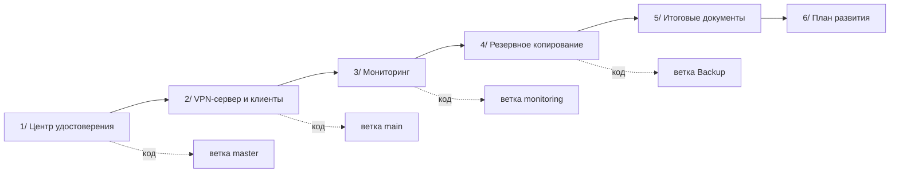

# Материалы и отчётные артефакты

## Содержание

- [Краткое описание](#краткое-описание)
- [Состав серверов](#состав-серверов)
- [Схема взаимодействия](#схема-взаимодействия)
- [Описание файлов](#описание-файлов)
- [Как пользоваться](#как-пользоваться)
- [Дополнительные комментарии](#дополнительные-комментарии)

## Краткое описание

Ветка не содержит кода. Здесь собраны скриншоты, документы и выгрузки, подтверждающие выполнение этапов проекта VPN-сервиса: центр удостоверения, VPN-сервер, мониторинг, резервное копирование, итоговая документация и план развития. Каталоги пронумерованы по порядку этапов. Развёртывание описано в ветках с кодом (`main`, `master`, `monitoring`, `Backup`), требований к инфраструктуре и предварительных установок у этой ветки нет.

## Состав серверов

Серверов в этой ветке нет. Материалы относятся к четырём серверам проекта:

| Сервер | Адрес | Этап (каталог) |
|---|---|---|
| Центр удостоверения | `CA_IP` | `1/` |
| VPN-сервер | `VPN_SERVER_IP` | `2/` |
| `server-monitoring` | `MONITORING_IP` | `3/` |
| `server-backup` | `BACKUP_IP` | `4/` |

## Схема взаимодействия

Ветки проекта и этапы, которые они подтверждают:

## Описание файлов

| Каталог | Этап | Содержимое |
|---|---|---|
| `1/` | Центр удостоверения | 5 скриншотов терминала: `init-pki`, создание CA, итоговое сообщение скрипта `setup_ca.sh` |
| `2/` | VPN-сервер и клиенты | Скриншоты листингов скриптов `setup_vpn_server.sh` (`set 1`, `set 2`, `set3`) и `gen-client` (`gen 1`, `gen 2`) и ещё 9 скриншотов с именами-идентификаторами |
| `3/` | Мониторинг | `d1.1.png`, `d1.2.png`, `d1.3.png`: страница алертов Prometheus (`localhost:9090`, правила `infra.yml`). Архив `takeout-…zip`: выгрузка писем Alertmanager в формате `.mbox` |
| `4/` | Резервное копирование | «Описание системы резервного копирования» и «Сценарии отказа системы резервного копирования» (docx), PDF-документ |
| `5/` | Итоговые документы | Руководство пользователя VPN, руководство системного администратора, схемы инфраструктуры и потоков данных (PDF), проектирование системы мониторинга, описание и сценарии отказа резервного копирования |
| `6/` | План развития | «Развитие инфраструктуры: анализ и план на полугодие» (docx) |

## Как пользоваться

- Для сдачи работы: откройте нужный каталог и приложите файлы этапа.
- Как справка: каждая инструкция в `5/` соответствует коду в другой ветке:

  | Документ | Ветка с кодом |
  |---|---|
  | Руководство пользователя, VPN-сервер | `main` |
  | Центр удостоверения | `master` |
  | Мониторинг | `monitoring` |
  | Резервное копирование | `Backup` |

## Дополнительные комментарии

Перед публикацией проверьте:

- В `3/` в архиве `takeout-…zip` лежат письма (`.mbox`). Просмотрите их, удалите адреса и другие личные данные либо не публикуйте архив.
- На скриншотах `3/` видна панель закладок браузера. Обрежьте скриншоты по окну страницы.
- Имя PDF в `4/` содержит ФИО. Переименуйте файл, если репозиторий открыт для посторонних.
- Файлы с именами вида `{GUID}.png` переименуйте по смыслу (например, `vpn-server-status.png`).
- Ссылки в документах `5/` проверьте на доступность из другого аккаунта.
- Секретов и ключей в ветке быть не должно.
