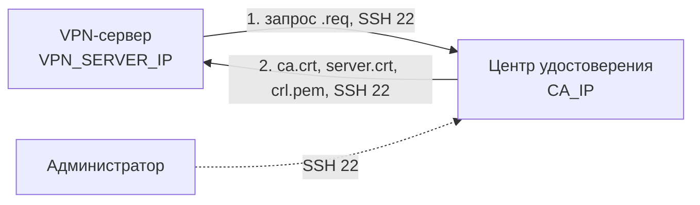

# Центр удостоверения (CA) на easy-rsa
 
> **ВНИМАНИЕ: в ветке лежат секреты.** Прочитайте раздел [Безопасность](#безопасность) до любых других действий.
 
## Содержание
 
- [Краткое описание](#краткое-описание)
- [Состав серверов](#состав-серверов)
- [Схема взаимодействия](#схема-взаимодействия)
- [Требования к инфраструктуре](#требования-к-инфраструктуре)
- [Что установить заранее](#что-установить-заранее)
- [Описание файлов](#описание-файлов)
- [Развёртывание CA](#развёртывание-ca)
- [Использование и проверка](#использование-и-проверка)
- [Безопасность](#безопасность)
- [Дополнительные комментарии](#дополнительные-комментарии)
## Краткое описание
 
Ветка содержит скрипты и пакет для развёртывания центра удостоверения (CA), который подписывает сертификаты VPN-сервера и клиентов. Это старая ветка проекта (август 2026), снимок домашнего каталога пользователя `sysadmin` на CA-сервере. Общий обзор проекта см. в ветке `main`.
 
## Состав серверов
 
| Сервер | Адрес | Роль в этой ветке |
|---|---|---|
| Центр удостоверения | `CA_IP` | Основной: здесь работают все скрипты ветки |
| VPN-сервер | `VPN_SERVER_IP` | Получает `ca.crt`, `server.crt` и `crl.pem`, присылает запросы на подпись |
 
Вместо `CA_IP` и `VPN_SERVER_IP` подставьте адреса своих серверов.
 
## Схема взаимодействия
 

 
CA не принимает подключений от пользователей. Единственный вход: SSH с адресов администраторов и с VPN-сервера.
 
## Требования к инфраструктуре
 
- Одна ВМ с Ubuntu 22.04 или 24.04, 2 vCPU, 2 ГБ RAM, 10 ГБ диска.
- Статический публичный адрес, входящий порт 22/tcp только с адресов администраторов и VPN-сервера.
- Пользователь с `sudo`, вход по SSH-ключу.
## Что установить заранее
 
`easy-rsa`, `vim` (скрипт `setup_ca.sh` установит их сам), `git`, `openssl`, клиент `ssh`/`scp`.
 
## Описание файлов
 
Всё лежит в каталоге `sysadmin/`:
 
| Путь | Назначение |
|---|---|
| `setup_ca.sh` | Создание CA: ставит `easy-rsa`, готовит `vars`, `init-pki`, `build-ca nopass`, настраивает iptables |
| `ca-signing` | Подпись запроса сервера и копирование `ca.crt` и `server.crt` на VPN-сервер |
| `easy-rsa-ca-0.1/` | Исходники deb-пакета `easy-rsa-ca` (каталог `debian/`, `setup_ca.sh`) |
| `easy-rsa-ca_0.1-1_all.deb` | Готовый пакет, ставит `setup_ca.sh` в `/home` |
| `easy-rsa-ca_0.1*` (`.dsc`, `.changes`, `.buildinfo`, `.build`, `.tar.xz`) | Артефакты сборки пакета |
| `easy-rsa/` | Рабочий каталог easy-rsa: `vars`, `pki/` (`ca.crt`, `private/ca.key`) |
| `.bash_history`, `.viminfo`, `.ssh/`, `.bashrc` и другие | Файлы домашнего каталога, случайно попавшие в репозиторий |
 
## Развёртывание CA
 
```bash
cd sysadmin
bash setup_ca.sh
```
 
Скрипт:
 
1. Обновляет систему и ставит `easy-rsa` и `vim`.
2. Создаёт `~/easy-rsa`, формирует `vars` (страна RUS, организация `ClearView UX`, алгоритм `ec`, дайджест `sha512`).
3. Выполняет `./easyrsa init-pki` и `./easyrsa build-ca nopass`.
4. Включает iptables: `INPUT` и `FORWARD` в DROP, разрешены установленные соединения, SSH (22/tcp), UDP 1194 и ping.
Результат: `~/easy-rsa/pki/ca.crt` (публичный сертификат, раздаётся) и `~/easy-rsa/pki/private/ca.key` (секрет).
 
## Использование и проверка
 
Подпись сертификата сервера. После того как VPN-сервер прислал `/tmp/server.req` (скрипт `yc-scp` из ветки `main`):
 
```bash
cd ~/easy-rsa
./easyrsa import-req /tmp/server.req server
./easyrsa sign-req server server
```
 
Клиентские сертификаты подписываются командой `./easyrsa sign-req client <имя>`, её вызывает `gen-client` из ветки `main`.
 
Отзыв сертификата и выпуск списка отзыва:
 
```bash
./easyrsa revoke <имя>
./easyrsa gen-crl          # скопировать crl.pem на VPN-сервер в /etc/openvpn/server/
```
 
Проверка:
 
```bash
openssl x509 -in ~/easy-rsa/pki/ca.crt -noout -subject -dates
openssl verify -CAfile ~/easy-rsa/pki/ca.crt ~/easy-rsa/pki/issued/server.crt
```
 
## Безопасность
 
В ветке обнаружены файлы, которых в репозитории быть не должно:
 
| Файл | Что в нём |
|---|---|
| `sysadmin/.ssh/id_ed25519` | Приватный SSH-ключ |
| `sysadmin/easy-rsa/pki/private/ca.key` | Приватный ключ центра удостоверения |
| `sysadmin/.bash_history`, `.viminfo` | История команд и правок: могут содержать адреса, имена и пароли |
 
Что сделать:
 
1. **Если репозиторий публичный или когда-либо был таким,** считайте оба ключа скомпрометированными. Замените SSH-ключ на всех серверах (`authorized_keys`) и **перевыпустите CA**, затем все сертификаты. Тот, у кого есть `ca.key`, может выпускать валидные сертификаты и подключаться к VPN.
2. Удалите файлы из всей истории git, а не только из последнего коммита:
```bash
git filter-repo --path sysadmin/.ssh --path sysadmin/easy-rsa/pki/private \
  --path sysadmin/.bash_history --path sysadmin/.viminfo --invert-paths
git push --force
```
3. Добавьте `.gitignore`: `*.key`, `.ssh/`, `.bash_history`, `.viminfo`, `pki/private/`, `*.swo`, `*.swp`.
4. Храните ключ CA только на CA-сервере, с правами `600`, и делайте его зашифрованную резервную копию.
## Дополнительные комментарии
 
- `setup_ca.sh` создаёт CA с `build-ca nopass`: ключ CA не защищён паролем. Для боевого CA уберите `nopass`.
- Правила iptables не сохраняются между перезагрузками. Установите `iptables-persistent` и выполните `netfilter-persistent save`.
- В `ca-signing` пути в `scp -i '$3'` стоят в одинарных кавычках, поэтому `$1`, `$2`, `$3` не раскрываются. Замените на двойные кавычки.
- В `ca-signing` жёстко задан путь `/home/sysadmin/easy-rsa`.
- Метаданные пакета не заполнены (`Maintainer: you@example.com`, `Homepage`), в `control` версия 0.1.0, в `changelog` 0.1-1.
- Каталог `easy-rsa/` содержит рабочее состояние PKI, а не исходники: его не нужно хранить в git.
 
