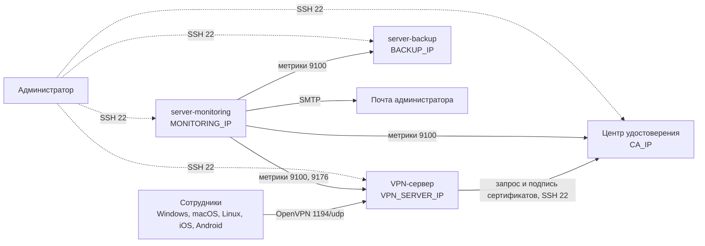

# VPN-сервис с собственным центром сертификации
 
Репозиторий содержит автоматизацию и документацию для базовой IT-инфраструктуры небольшой консалтинговой компании (UX/UI-дизайн): защищённый удалённый доступ по VPN, собственный центр удостоверения (CA), мониторинг и резервное копирование. Ветка `main` является точкой входа: здесь обзор проекта, карта веток и пакет для VPN-сервера.
 
## Содержание
 
- [Краткое описание](#краткое-описание)
- [Состав серверов](#состав-серверов)
- [Схема взаимодействия](#схема-взаимодействия)
- [Карта веток](#карта-веток)
- [Требования к инфраструктуре](#требования-к-инфраструктуре)
- [Что установить заранее](#что-установить-заранее)
- [Описание файлов ветки](#описание-файлов-ветки)
- [Развёртывание VPN-сервера](#развёртывание-vpn-сервера)
- [Использование и проверка](#использование-и-проверка)
- [Дополнительные комментарии](#дополнительные-комментарии)
## Краткое описание
 
**Проблема.** Сотрудники используют личные почтовые ящики и публичные облачные диски, нет централизованного контроля доступа и аудита, удалённые сотрудники работают через публичные Wi-Fi, а при увольнении документы остаются в личных аккаунтах.
 
**Решение.**
 
1. Доступ к ресурсам компании только через VPN (OpenVPN).
2. Сертификаты вместо паролей с возможностью быстро отозвать доступ.
3. Воспроизводимость: серверы поднимаются скриптами и пакетами.
4. Мониторинг и оповещения о сбоях на e-mail.
5. Резервное копирование с проверкой восстановления.
6. Документация для пользователей и администраторов.
## Состав серверов
 
В таблице вместо `VPN_SERVER_IP`, `CA_IP`, `MONITORING_IP`, `BACKUP_IP` подставьте адреса своих серверов.
 
| Сервер | Адрес | Роль | ПО | Ветка |
|---|---|---|---|---|
| VPN-сервер | `VPN_SERVER_IP` | Точка входа пользователей | OpenVPN, node_exporter, openvpn_exporter | `main` |
| Центр удостоверения | `CA_IP` | Выпуск и отзыв сертификатов | easy-rsa, node_exporter | `master` |
| `server-monitoring` | `MONITORING_IP` | Мониторинг и оповещения | Prometheus, Alertmanager, blackbox_exporter | `monitoring` |
| `server-backup` | `BACKUP_IP` | Резервные копии | restic, node_exporter | `Backup` |
 
## Схема взаимодействия
 

 
| Поток | Откуда → куда | Порт | Что передаётся |
|---|---|---|---|
| VPN-подключение | Пользователь → VPN-сервер | 1194/udp | Зашифрованный трафик, TLS с сертификатом клиента |
| Подпись сертификатов | VPN-сервер → CA | 22/tcp (SSH) | Запросы `.req`, подписанные `.crt` |
| Метрики | `server-monitoring` → все ВМ | 9100/tcp, 9176/tcp | Метрики node_exporter и openvpn_exporter |
| Алерты | `server-monitoring` → почта | 587/tcp | Письма Alertmanager |
| Управление | Администратор → все ВМ | 22/tcp | SSH-доступ |
 
## Карта веток
 
| Ветка | Что внутри | Когда использовать |
|---|---|---|
| `main` | Обзор, пакет `vpn-ca-utils_2.0_all.deb` для VPN-сервера | Развёртывание VPN-сервера |
| `master` | Скрипты и пакет `easy-rsa-ca` для центра удостоверения | Развёртывание CA. Содержит секреты, см. README ветки |
| `monitoring` | Prometheus, Alertmanager, 33 алерта, пакеты `monitoring-server` и `monitoring-agent` | Развёртывание мониторинга |
| `Backup` | Пакеты `backup-storage` и `prometheus-config`, исходники | Развёртывание резервного копирования |
| `Artifact` | Скриншоты, документы, отчёты по этапам | Отчётность, справка |
 
## Требования к инфраструктуре
 
- Четыре виртуальные машины (Ubuntu 24.04 или 22.04), статические публичные адреса.
- Минимальные ресурсы:
  | ВМ | vCPU | RAM | Диск |
  |---|---|---|---|
  | VPN-сервер | 2 | 2 ГБ | 15 ГБ |
  | CA | 2 | 2 ГБ | 10 ГБ |
  | `server-monitoring` | 2 | 4 ГБ | 30 ГБ |
  | `server-backup` | 2 | 2 ГБ | по объёму данных |
- Входящие порты: 1194/udp на VPN-сервере из интернета, 22/tcp на все ВМ только с адресов администраторов, 9100 и 9176 только с `MONITORING_IP`.
- Доступ по SSH с ключами, пользователь с `sudo`.
- Точное время на всех ВМ (NTP): от него зависит проверка сертификатов.
- Почтовый ящик с SMTP для оповещений.
## Что установить заранее
 
На каждой ВМ: `git`, `curl`. Для VPN-сервера: `openvpn`, `easy-rsa`, `iptables-persistent` (их ставит `setup_vpn_server.sh`). На машине администратора: клиент `ssh`/`scp`. Для создания ВМ в Yandex Cloud: консольная утилита `yc`.
 
## Описание файлов ветки
 
| Файл | Назначение |
|---|---|
| `README.md` | Этот файл |
| `vpn-ca-utils_2.0_all.deb` | Пакет с конфигурацией OpenVPN и скриптами для VPN-сервера |
 
Состав пакета `vpn-ca-utils` 2.0:
 
| Файл в пакете | Назначение |
|---|---|
| `/etc/openvpn/server.conf` | Конфигурация OpenVPN 2.6: `1194/udp`, `tun`, `tls-crypt`, шифры AES-256-GCM, AES-128-GCM, CHACHA20-POLY1305, сеть клиентов `VPN_SUBNET`, весь трафик через VPN |
| `/tmp/client.conf.template` | Шаблон клиентского профиля |
| `~/setup_vpn_server.sh` | Подготовка сервера: пакеты, `ip_forward`, iptables, PKI easy-rsa, ключи |
| `~/yc-scp` | Отправка запроса сертификата сервера на CA |
| `~/mv-OpenVPN` | Установка `ca.crt` и `server.crt`, проверка ключа, запуск `openvpn-server@server` |
| `~/gen-client` | Выпуск клиента: ключ и запрос, подпись на CA по SSH, сборка единого `.ovpn` |
 
Скрипты читают параметры из `ovpn.env`: `PROTO`, `PORT`, `SSH_PORT`, `VPN_NET`, `IPTABLES_RULES`, `PKI_DIR`, `SERVER_DIR`, `CLIENT_DIR`, `VPN_SERVER_IP`, `CA_HOST`, `CA_USER`, `CA_DIR`, `CA_KEY`. Файла в пакете нет, его нужно создать.
 
## Развёртывание VPN-сервера
 
Сначала должен быть готов CA (ветка `master`).
 
1. Установите пакет и создайте `ovpn.env`:
```bash
sudo apt install /tmp/vpn-ca-utils_2.0_all.deb
cp /etc/openvpn/server.conf ~/server.conf
nano ~/ovpn.env
```
2. Подготовьте сервер. На время настройки фаервол открыт, затем политика меняется на DROP:
```bash
./setup_vpn_server.sh
```
3. Отправьте запрос на подпись и подпишите его на CA:
```bash
./yc-scp <user> CA_IP <путь_к_ssh_ключу>
# на CA: ./easyrsa import-req /tmp/server.req server && ./easyrsa sign-req server server
scp <user>@CA_IP:~/easy-rsa/pki/ca.crt /tmp/ca.crt
scp <user>@CA_IP:~/easy-rsa/pki/issued/server.crt /tmp/server.crt
```
4. Установите сертификаты и запустите службу:
```bash
sudo ./mv-OpenVPN
```
 
## Использование и проверка
 
Выпуск клиентского профиля:
 
```bash
./gen-client ivanov
```
 
Результат: `$CLIENT_DIR/ivanov/ivanov.ovpn`. Передайте файл пользователю безопасным каналом.
 
Проверка сервера:
 
```bash
systemctl status openvpn-server@server    # active (running)
ip a show tun0                            # адрес VPN_GATEWAY_IP
sudo ss -ulnp | grep 1194                 # порт слушается
```
 
Затем подключитесь тестовым клиентом. Инструкция для пользователей лежит в ветке `Artifact`.
 
## Дополнительные комментарии
 
Замечания выявлены при разборе пакета и требуют исправления до эксплуатации:
 
- **Отзыв сертификатов не включён.** В `server.conf` строка `crl-verify` закомментирована, отозванный сертификат продолжит работать. Создайте `crl.pem` на CA (`./easyrsa gen-crl`), скопируйте в `/etc/openvpn/server/` и раскомментируйте строку.
- **Пакет собран неверно.** Скрипты лежат в буквальных каталогах `~/` и `/tmp` внутри пакета, при установке они окажутся в `/~/` и `/tmp`. Перенесите их в `/usr/local/sbin`.
- **Нет `ovpn.env`.** Без него скрипты не запустятся.
- **Мониторинг OpenVPN не заработает без правки.** Ветка `monitoring` требует `status-version 2`, в `server.conf` этой строки нет.
- **Ключ клиента создаётся на VPN-сервере** и вшивается в `.ovpn`. Руководство пользователя описывает другой вариант: клиент сам делает запрос. Выберите один подход.
- **Метаданные пакета не заполнены:** описание, `Homepage`, `Section: unknown`, почта сопровождающего.
- **Пароль CA.** `gen-client` ожидает ввод пароля CA, а скрипт установки CA создаёт его без пароля (`build-ca nopass`).
 
